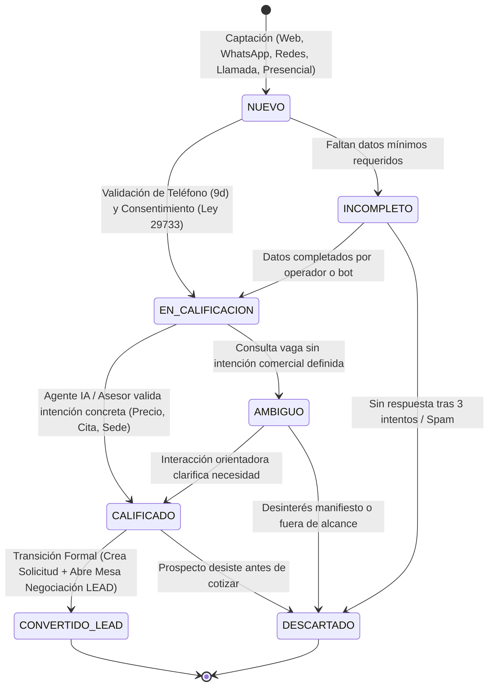
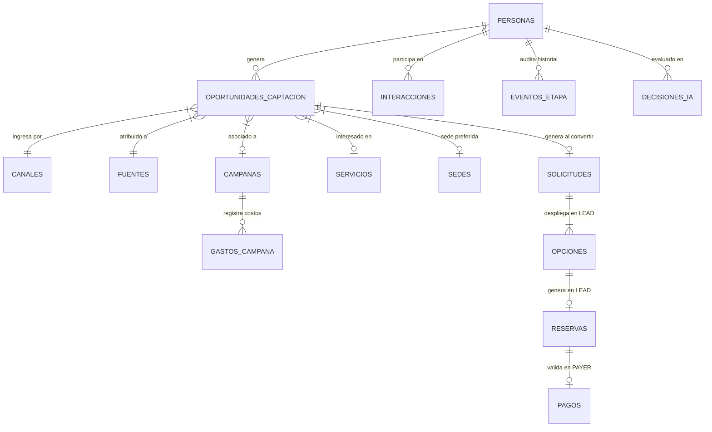
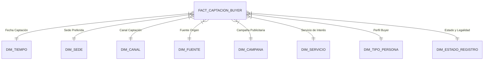

# ARQUITECTURA OBJETIVO Y PROPUESTA DE REDISEÑO INTEGRAL: FASE BUYER NEXOSALUD

**Sistema:** NexoSalud Dental Management & BI System  
**Metodología:** IMPULSE (Buyer → Lead → Payer → Customer → Turned)  
**Fecha:** 26 de Octubre de 2026  
**Rama de Trabajo:** `refactor/buyer-impulse-integral`  

---

## 1. VISIÓN Y PRINCIPIOS DE REDISEÑO

El rediseño integral de la fase **BUYER** persigue transformar una implementación fragmentada y con atajos provisionales en una arquitectura empresarial robusta, trazable, legalmente blindada bajo la **Ley N° 29733 de Protección de Datos Personales (Perú)** y matemáticamente sincronizada con el **Data Mart de Inteligencia de Negocios**.

### Principios Rectores:
1. **Aislamiento Estricto de Dominio (Bounded Context):** BUYER es una etapa exclusivamente comercial y de admisión. Queda prohibida la captura de datos clínicos o anamnesis en esta fase.
2. **Unicidad de Identidad vs Multiplicidad de Oportunidades:** Una persona física posee un único expediente maestro en `Personas`. Sus diferentes intentos de contacto a lo largo del tiempo se modelan como tuplas independientes en `OportunidadesCaptacion`.
3. **Máquina de Estados Determinista:** Ningún usuario captado por la web salta directamente a LEAD. Todo interesado debe pasar por la evaluación y calificación de BUYER.
4. **Inteligencia Artificial Segura y Persistida (Human-in-the-Loop):** El Agente de Marketing corre en backend, utiliza modelos LLM validados, sanitiza entradas y registra cada inferencia en `DecisionesIA`.
5. **Data Mart con Grano Inequívoco:** `Fact_CaptacionBuyer` adopta el grano por Oportunidad de Captación, erradicando los NULLs en dimensiones y prorrateando financieramente los costos de `GastosCampana`.
6. **KPIs Alimentados por el Data Mart:** La interfaz de usuario consume métricas consolidadas directamente desde la base dimensional, eliminando cálculos en memoria en el navegador y tendencias hardcodeadas.

---

## 2. MODELO FUNCIONAL Y MÁQUINA DE ESTADOS DE BUYER



### Reglas de Transición y Salvaguardas:
- **R-BUY-01 (Entrada Válida):** Requiere nombre completo, teléfono móvil de 9 dígitos (formato Perú `^9\d{8}$`), canal de origen y consentimiento expreso (`autoriza_contacto = 1` con timestamp).
- **R-BUY-02 (Aislamiento de Consentimiento):** Queda prohibida la sobreescritura automática de `autoriza_contacto` en el backend.
- **R-BUY-03 (Calificación de Intención):** Para pasar a `CALIFICADO`, la oportunidad debe vincular un `servicio_de_interes` del catálogo básico y un `motivo_consulta` con intención administrativa concreta.
- **R-BUY-04 (Paso a LEAD):** La creación de la fila en `Solicitudes` y el evento en `EventosEtapa` (origen: BUYER, destino: LEAD) ocurre **únicamente** cuando la oportunidad transiciona a `CONVERTIDO_LEAD`.

---

## 3. MODELO TRANSACCIONAL (OLTP) PROPUESTO

### 3.1. Incorporación de la Entidad `OportunidadesCaptacion`
Para resolver la colisión de prospectos recurrentes y desacoplar la persona física de sus contactos de marketing, se introduce la entidad `OportunidadesCaptacion`:

```sql
CREATE TABLE OportunidadesCaptacion (
    id_oportunidad          INT IDENTITY(1,1) PRIMARY KEY,
    id_persona              INT NOT NULL,
    id_canal                INT NOT NULL,
    id_fuente               INT NOT NULL,
    id_campana              INT NULL,
    id_servicio_interes     INT NULL,
    id_sede_preferida       INT NULL,
    
    estado_oportunidad      VARCHAR(30) NOT NULL DEFAULT 'NUEVO',
    motivo_consulta         VARCHAR(300) NOT NULL,
    franja_horaria_pref     VARCHAR(50) NULL,
    lead_score              TINYINT NULL DEFAULT 0,
    
    fecha_captacion         DATETIME2 NOT NULL DEFAULT SYSDATETIME(),
    fecha_primera_respuesta DATETIME2 NULL,
    fecha_calificacion      DATETIME2 NULL,
    fecha_conversion        DATETIME2 NULL,
    fecha_cierre            DATETIME2 NULL,
    motivo_descarte         VARCHAR(200) NULL,
    
    id_usuario_asignado     INT NULL,
    id_solicitud_lead       INT NULL, -- Vincula a Solicitudes tras convertir
    
    CONSTRAINT FK_Oportunidades_Persona FOREIGN KEY (id_persona) REFERENCES Personas(id_persona),
    CONSTRAINT FK_Oportunidades_Canal FOREIGN KEY (id_canal) REFERENCES Canales(id_canal),
    CONSTRAINT FK_Oportunidades_Fuente FOREIGN KEY (id_fuente) REFERENCES Fuentes(id_fuente),
    CONSTRAINT FK_Oportunidades_Campana FOREIGN KEY (id_campana) REFERENCES Campanas(id_campana),
    CONSTRAINT FK_Oportunidades_Servicio FOREIGN KEY (id_servicio_interes) REFERENCES Servicios(id_servicio),
    CONSTRAINT FK_Oportunidades_Sede FOREIGN KEY (id_sede_preferida) REFERENCES Sedes(id_sede),
    CONSTRAINT FK_Oportunidades_Usuario FOREIGN KEY (id_usuario_asignado) REFERENCES Usuarios(id_usuario),
    CONSTRAINT FK_Oportunidades_Solicitud FOREIGN KEY (id_solicitud_lead) REFERENCES Solicitudes(id_solicitud),
    CONSTRAINT CK_Oportunidades_Estado CHECK (estado_oportunidad IN ('NUEVO', 'INCOMPLETO', 'EN_CALIFICACION', 'AMBIGUO', 'CALIFICADO', 'CONVERTIDO_LEAD', 'DESCARTADO'))
);
```

### 3.2. Saneamiento de `Personas` y `PersonaSaludOdontologica`
- Se elimina la captura de `PersonaSaludOdontologica` en BUYER. Dicha tabla se mantiene en OLTP para uso exclusivo de las fases LEAD (mesa clínica) y CUSTOMER (acto médico).
- `Personas` se restringe a datos maestros de identidad civil, contacto y estado legal: `dni`, `nombres`, `apellidos`, `numero`, `email`, `autoriza_contacto`, `fecha_autorizacion`.

### 3.3. Diagrama Entidad-Relación Propuesto (Área BUYER y Conexiones)



---

## 4. MODELO DIMENSIONAL PROPUESTO (DATA MART)

### 4.1. Análisis y Selección de la Granularidad
Se analizaron las tres alternativas arquitectónicas exigidas:
- **Alternativa A: Una fila por persona registrada.**  
  *Evaluación:* Insuficiente. Impide registrar de manera aislada que un mismo paciente vuelva a ser captado por otra campaña 6 meses después; confunde la identidad demográfica con el evento comercial.
- **Alternativa B: Una fila por oportunidad de captación (RECOMENDADA Y SELECCIONADA).**  
  *Justificación Técnica:* Cada contacto o intento de captación posee fecha, canal, fuente, campaña y servicio de interés específico. Permite calcular con exactitud la tasa de conversión por cohorte, el CAC por oportunidad y el desglose multidimensional por tratamiento y sede.
- **Alternativa C: Una fila por interacción o evento de captación.**  
  *Evaluación:* Provoca fan-out y explosión volumétrica. Un paciente puede cruzar 10 mensajes de WhatsApp en su triaje. Multiplicar las medidas aditivas (`contacto_registrado`) en cada mensaje destruiría la métrica de volumen. (Las interacciones pertenecen a una tabla de hechos de detalle complementaria, no al hecho central de captación).

### 4.2. Esquema Estrella Objetivo: `Fact_CaptacionBuyer`

```sql
CREATE TABLE dbo.fact_captacion_buyer (
    id_captacion_buyer          BIGINT IDENTITY(1,1) PRIMARY KEY, -- Clave Subrogada
    id_oportunidad_origen       INT NOT NULL UNIQUE,              -- Clave Natural / Degenerada
    
    -- Claves Foráneas a Dimensiones Conformadas
    KeyTiempoCaptacion          INT NOT NULL FOREIGN KEY REFERENCES dbo.Dim_Tiempo(KeyTiempo),
    KeyTiempoConversion         INT NULL FOREIGN KEY REFERENCES dbo.Dim_Tiempo(KeyTiempo),
    KeySede                     INT NOT NULL FOREIGN KEY REFERENCES dbo.Dim_Sede(KeySede),
    KeyCanal                    INT NOT NULL FOREIGN KEY REFERENCES dbo.Dim_Canal(KeyCanal),
    KeyFuente                   INT NOT NULL FOREIGN KEY REFERENCES dbo.Dim_Fuente(KeyFuente),
    KeyCampana                  INT NOT NULL FOREIGN KEY REFERENCES dbo.Dim_Campana(KeyCampana),
    KeyServicioInteres          INT NOT NULL FOREIGN KEY REFERENCES dbo.Dim_Servicio(KeyServicio),
    KeyTipoPersona              INT NOT NULL FOREIGN KEY REFERENCES dbo.Dim_TipoPersona(KeyTipoPersona),
    KeyEstadoRegistro           INT NOT NULL FOREIGN KEY REFERENCES dbo.Dim_EstadoRegistro(KeyEstadoRegistro),
    
    -- Medidas Base del Negocio (Snake_case, Singular)
    contacto_registrado         INT NOT NULL DEFAULT 1,
    contacto_utilizable         INT NOT NULL DEFAULT 0, -- 1 si cumple Ley 29733 y validación, 0 si no
    conversion_lead             INT NOT NULL DEFAULT 0, -- 1 si avanzó a LEAD, 0 si no
    tiempo_conversion_dia       INT NULL DEFAULT 0,     -- DATEDIFF en días
    costo_atribuido_captacion   DECIMAL(10,2) NOT NULL DEFAULT 0.00 -- Prorrateo financiero real
);
```

### 4.3. Diagrama del Esquema Estrella de BUYER



---

## 5. REDISEÑO DEL PROCESO ETL

El proceso ETL se reestructura mediante un procedimiento almacenado transaccional e idempotente en T-SQL (`sp_ETL_Carga_Fact_CaptacionBuyer`):

1. **Staging y Normalización:** Extracción incremental desde `OportunidadesCaptacion` y `Personas` hacia `#Stg_Buyer`.
2. **Tratamiento de Miembros No Especificados:** Cualquier clave foránea que llegue nula se sustituye por `Key = 0` ('No especificado') evitando el valor `NULL` en hechos.
3. **Prorrateo Matemático de Costos de Campaña:**
   ```sql
   ;WITH GastosMes AS (
       SELECT id_campana, FORMAT(fecha, 'yyyyMM') AS AnioMes, SUM(importe) AS GastoTotal
       FROM NexoSaludDB.dbo.GastosCampana
       GROUP BY id_campana, FORMAT(fecha, 'yyyyMM')
   ),
   ContactosMes AS (
       SELECT id_campana, FORMAT(fecha_captacion, 'yyyyMM') AS AnioMes, COUNT(*) AS TotalContactos
       FROM NexoSaludDB.dbo.OportunidadesCaptacion
       WHERE id_campana IS NOT NULL
       GROUP BY id_campana, FORMAT(fecha_captacion, 'yyyyMM')
   )
   SELECT 
       s.id_oportunidad,
       ISNULL(g.GastoTotal / NULLIF(c.TotalContactos, 0), 0.00) AS CostoUnitarioProrrateado
   ...
   ```
4. **Carga Idempotente con `MERGE`:** Se ejecuta un `MERGE` sobre `id_oportunidad_origen` actualizando las conversiones tardías (`conversion_lead`, `KeyTiempoConversion`, `tiempo_conversion_dia`) cuando el prospecto avanza en fechas posteriores.
5. **Auditoría de Carga:** Registro en `Log_Ejecucion_ETL` con BatchId, duración y conteo de filas afectadas.

---

## 6. REDISEÑO DE BACKEND Y CONTRATOS DE API

### Arquitectura de Servicios en Backend:
- `backend/src/services/buyerService.ts`: Lógica de dominio, creación de oportunidades, control de máquina de estados.
- `backend/src/services/marketingAgentService.ts`: Integración segura con Groq SDK server-side, sanitización de prompts, registro en `DecisionesIA`.
- `backend/src/services/buyerAlertService.ts`: Evaluación reactiva de las 4 Impulse Alerts.

### Contratos de API Principales:

#### 1. Ingesta Pública de Formulario Web (Pública con Rate Limit)
- **Ruta:** `POST /api/buyer/public-intake`
- **Payload:**
  ```json
  {
    "nombres": "Lucía",
    "apellidos": "Mendoza",
    "numero": "987654321",
    "email": "lucia.mendoza@example.com",
    "id_servicio_interes": 2,
    "sede_preferida": "Sede California",
    "franja_horaria_pref": "Tarde (13:00 - 18:00)",
    "motivo_consulta": "¿Cuál es el costo del tratamiento de brackets y qué días atienden?",
    "autoriza_contacto": true
  }
  ```
- **Respuesta (201 Created):**
  ```json
  {
    "success": true,
    "opportunityId": 104,
    "state": "EN_CALIFICACION",
    "message": "Solicitud recibida. Un asesor se comunicará contigo tras validar tu requerimiento."
  }
  ```

#### 2. Análisis del Agente de Marketing (Autenticado / Privado)
- **Ruta:** `POST /api/buyer/opportunities/:id/analyze-ai`
- **Respuesta (200 OK):**
  ```json
  {
    "opportunityId": 104,
    "aiAnalysis": {
      "intentLevel": "ALTA",
      "leadScore": 92,
      "intentReason": "Solicita precio específico de ortodoncia y disponibilidad horaria en Sede California.",
      "suggestedAction": "CONVERT_TO_LEAD",
      "marketingRecommendation": "Transferir a mesa de negociación LEAD para formular alternativas de agenda.",
      "serviceClassification": "Ortodoncia Inicial"
    },
    "auditDecisionId": 45
  }
  ```

#### 3. Conversión Formal a LEAD (Autenticado con Salvaguardas)
- **Ruta:** `POST /api/buyer/opportunities/:id/convert-lead`
- **Regla:** Valida `autoriza_contacto == true`. Si la intención es ambigua, exige `{ "forzar": true, "justificacion_humana": "..." }`.
- **Acción:** Crea `Solicitudes`, actualiza oportunidad a `CONVERTIDO_LEAD` y registra `EventosEtapa`.

---

## 7. REDISEÑO DE FRONTEND Y EXPERIENCIA DE USUARIO (UI/UX)

1. **Pantalla Principal (`BuyerListView.tsx`):**
   - **Remoción de Strings Simulados:** Eliminación de tendencias hardcodeadas (`+12.4%`, etc.).
   - **Banner Proactivo de Impulse Alerts:** Barra superior persistente que totaliza:
     - ⚠️ `X Registros Incompletos`
     - 👥 `Y Posibles Duplicados`
     - ⚖️ `Z Sin Autorización Legal`
     - ❓ `W Consultas con Intención Ambigua`
     *(Al hacer clic en cualquier chip se filtra automáticamente la tabla).*
2. **Formulario de Registro Administrativo:**
   - Supresión completa de los paneles de dolor, sensibilidad y antecedentes odontológicos.
   - Enfoque ágil en 4 campos esenciales: Identificación, Contacto, Interés de Tratamiento y Consentimiento.
3. **Consumo de KPIs desde el Mart:**
   - La cabecera consulta el endpoint analítico `/api/reports/kpis/buyer`, mostrando valores reales consolidados con indicador de última sincronización.

---

## 8. CLASIFICACIÓN FORMAL DE CAMBIOS ARQUITECTÓNICOS

| Clasificación | Elemento Afectado | Justificación Técnica |
|---|---|---|
| **CORREGIR** | Endpoint `POST /api/buyer/register` | Eliminar asignación directa de `id_etapa_actual = LEAD` para registros web; respetar ingreso formal a BUYER. |
| **CORREGIR** | Endpoint `POST /api/buyer/:id/convert` | Eliminar forzado automático de `autoriza_contacto = true` que vulnera la Ley 29733. |
| **CORREGIR** | Identificadores de modelos en `groqService.ts` | Homologar a modelos reales soportados (`llama-3.3-70b-versatile` y `llama-3.1-8b-instant`). |
| **CORREGIR** | Mapeo ETL de Sedes en `etl_populate_mart.sql` | Eliminar `CASE` de urbanizaciones escritas a mano; vincular con la sede física de preferencia. |
| **CORREGIR** | Cruce de Campañas en ETL | Corregir join erróneo `p.id_campana_origen = df.id_campana` en `Dim_Fuente`. |
| **MODIFICAR** | Tabla dimensional `fact_captacion_buyer` | Cambiar PK compuesta por clave subrogada y grano fino por oportunidad de captación con miembros conformados. |
| **MODIFICAR** | Cálculo de KPI B1 en Frontend | Migrar consumo analítico hacia el Data Mart con tratamiento de cohortes maduras (>= 14 días). |
| **MODIFICAR** | Cálculo de KPI B3 en Frontend | Reemplazar diccionario estático `DEFAULT_SOURCE_COSTS` por medida `costo_atribuido_captacion` prorrateada del Mart. |
| **MODIFICAR** | Componente `BuyerListView.tsx` | Reemplazar tendencias hardcodeadas por comparación MoM real y añadir panel proactivo de alertas. |
| **ELIMINAR** | Entrada de datos médicos en BUYER | Desacoplar `PersonaSaludOdontologica` del módulo de admisión comercial. |
| **ELIMINAR** | Exposición de `VITE_GROQ_API_KEY` en bundle cliente | Retirar claves de API y prompts del frontend. |
| **AGREGAR** | Entidad relacional `OportunidadesCaptacion` | Permitir múltiples oportunidades por persona sin duplicar expedientes ni sobreescribir consentimientos. |
| **AGREGAR** | Servicio backend `MarketingAgentService` | Orquestar llamadas de inferencia LLM seguras desde Node.js con sanitización y logging. |
| **AGREGAR** | Persistencia obligatoria en `DecisionesIA` | Registrar cada auditoría, prompt hash, score y justificación del modelo en SQL Server. |
| **AGREGAR** | Endpoint analítico `/api/reports/kpis/buyer` | Entregar indicadores oficiales calculados por el motor T-SQL del Data Mart. |
| **CONSERVAR** | Estructura de identidad única en `Personas` | Mantener DNI, nombres y datos de contacto centralizados. |
| **CONSERVAR** | Bitácora omnicanal en `Interacciones` | Conservar trazabilidad cronológica de mensajes entrantes y salientes. |
| **CONSERVAR** | Tabla de hechos de auditoría en `EventosEtapa` | Preservar historial de saltos de etapa para alimentar análisis de tiempos de ciclo IMPULSE. |

---

## 9. EVALUACIÓN DE IMPACTO SOBRE OTRAS ETAPAS IMPULSE

- **Impacto en LEAD:**  
  *Positivo y estabilizador.* Al no auto-convertir todo registro web a LEAD, la mesa de negociación de LEAD solo recibirá prospectos verdaderamente calificados con intención confirmada y autorización legal. No se altera la estructura de `Solicitudes`, `Opciones` ni `Reservas`; `Solicitudes` se creará formalmente al convertir desde `OportunidadesCaptacion`.
- **Impacto en PAYER:**  
  *Nulo / Transparente.* PAYER continúa consumiendo `Reservas` y validando `Pagos`. La mejora en la calidad de datos de BUYER reduce la tasa de inasistencia y de pagos rechazados.
- **Impacto en CUSTOMER y TURNED:**  
  *Positivo.* Al no duplicar personas en BUYER, la historia clínica de `Atenciones` y los contactos de `Seguimientos` en TURNED se mantienen sólidamente anclados al mismo `id_persona` a lo largo de los años.
