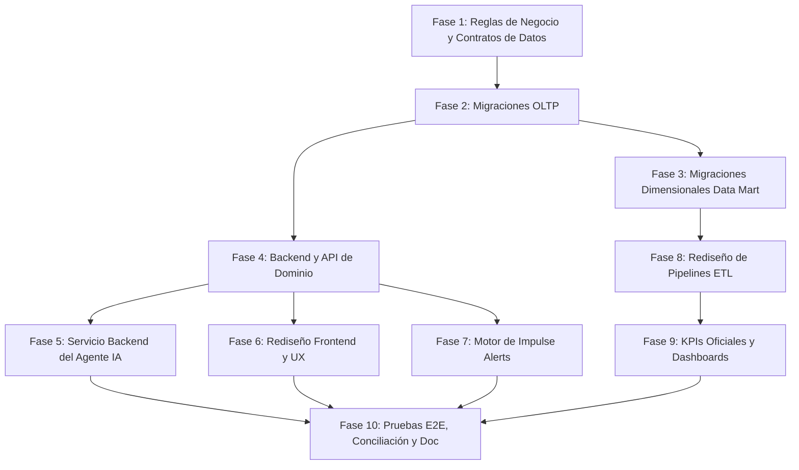

# PLAN SECUENCIAL DE IMPLEMENTACIÓN — REDISEÑO FASE BUYER NEXOSALUD

**Fase:** BUYER (NexoSalud Dental Management & BI System)  
**Fecha:** 26 de Octubre de 2026  
**Rama de Preparación:** `refactor/buyer-impulse-integral`  
**Estrategia General:** Implementación progresiva por capas, no destructiva, con preservación histórica y rollback planificado.

---

## 1. ORDEN SECUENCIAL Y DEPENDENCIAS

---

## 2. DETALLE DE FASES DE IMPLEMENTACIÓN

### Fase 1: Reglas de Negocio y Contratos de Datos (Zod & DTOs)
- **Archivos Afectados:**
  - `src/domain/entities.ts`
  - `src/modules/buyer/schemas/buyerSchema.ts`
  - `backend/src/schemas/buyerValidation.ts` (Nuevo)
- **Pasos Técnicos:**
  1. Definir esquemas Zod estrictos para `PublicBuyerIntakeDTO`, `BuyerOpportunityDTO` y `AiAnalysisResultDTO`.
  2. Formalizar el validador de número peruano (`^9\d{8}$`) y validación booleana estricta de `autoriza_contacto === true`.
  3. Establecer tipos de estados (`NUEVO`, `EN_CALIFICACION`, `CALIFICADO`, `CONVERTIDO_LEAD`, `DESCARTADO`).
- **Esfuerzo:** 1 día.
- **Criterio de Cierre:** Tests unitarios de validación aprobados al 100%.

---

### Fase 2: Migraciones de Base de Datos Transaccional (OLTP)
- **Archivos Afectados:**
  - `database/init_oltp.sql`
  - `backend/prisma/schema.prisma`
  - `backend/prisma/migrations/`
- **Pasos Técnicos:**
  1. Ejecutar script DDL `ddl_propuesto_oltp_buyer.sql` para crear `OportunidadesCaptacion` sin alterar tablas existentes.
  2. Generar migración reversible de Prisma (`npx prisma migrate dev --name add_oportunidades_captacion`).
  3. Ejecutar script de backfill/población de compatibilidad para vincular las personas existentes en BUYER a su primera oportunidad.
- **Estrategia de Rollback:** `DROP TABLE dbo.OportunidadesCaptacion;` (las tablas `Personas` y `Solicitudes` no sufren cambios destructivos).
- **Esfuerzo:** 1.5 días.
- **Criterio de Cierre:** Integridad referencial y claves foráneas validadas en SQL Server `NexoSaludDB`.

---

### Fase 3: Migraciones Dimensionales (Data Mart)
- **Archivos Afectados:**
  - `database/init_mart.sql`
  - `NexoSalud_BUYER_Auditoria/06_Rediseno_Propuesto/ddl_propuesto_mart_buyer.sql`
- **Pasos Técnicos:**
  1. Asegurar registros comodín (`Key = 0`, 'No especificado') en todas las dimensiones conformadas.
  2. Crear la tabla de hechos evolucionada `fact_captacion_buyer_v2` con clave subrogada y grano por oportunidad (`id_oportunidad_origen` UNIQUE).
  3. Crear vista de compatibilidad hacia reportes legados: `CREATE OR ALTER VIEW dbo.vw_fact_captacion_buyer_legacy AS ...`.
- **Estrategia de Rollback:** `DROP TABLE dbo.fact_captacion_buyer_v2;`.
- **Esfuerzo:** 1 día.
- **Criterio de Cierre:** Esquema estrella compilado en `NexoSalud_Mart` con todas sus FKs activas.

---

### Fase 4: Backend y API de Dominio
- **Archivos Afectados:**
  - `backend/src/routes/buyer.routes.ts`
  - `backend/src/services/buyerService.ts` (Nuevo)
  - `backend/src/index.ts`
- **Pasos Técnicos:**
  1. Implementar `POST /api/buyer/public-intake`: crea `Personas` (si es nueva) y `OportunidadesCaptacion` en estado `NUEVO` o `EN_CALIFICACION`, respetando la etapa BUYER (NO asignar LEAD de inmediato).
  2. Corregir `POST /api/buyer/:id/convert`: eliminar sobreescritura de consentimiento forzado; exigir `autoriza_contacto == true`.
  3. Ajustar `GET /api/buyer`: filtrar por oportunidades comerciales activas en lugar de traer a todos los pacientes de fases avanzadas.
  4. Agregar middlewares de autenticación y autorización (`requireRole(['Administrador', 'Marketing'])`).
- **Esfuerzo:** 2.5 días.
- **Criterio de Cierre:** Endpoints cubiertos por tests de integración con Supertest en Node.js.

---

### Fase 5: Servicio Backend del Agente de Marketing (IA Segura)
- **Archivos Afectados:**
  - `backend/src/services/marketingAgentService.ts` (Nuevo)
  - `backend/.env`
  - `src/shared/services/groqService.ts` (Refactor)
- **Pasos Técnicos:**
  1. Instalar `@groq/groq-sdk` en backend.
  2. Configurar llamada segura a `llama-3.3-70b-versatile` con fallback a `llama-3.1-8b-instant` y fallback determinista por reglas de negocio.
  3. Implementar sanitización contra Prompt Injection y exclusión de datos personales (pseudonimización).
  4. Persistir cada inferencia en `DecisionesIA` (`agente = 'MARKETING_AGENT'`, prompt hash, tokens, latencia, decisión, acción sugerida).
  5. Exponer endpoint `POST /api/buyer/opportunities/:id/analyze-ai`.
- **Esfuerzo:** 2 días.
- **Criterio de Cierre:** Ejecución de los 17 casos de la batería de pruebas; persistencia confirmada en `DecisionesIA`.

---

### Fase 6: Rediseño Frontend y Experiencia de Usuario (UI/UX)
- **Archivos Afectados:**
  - `src/modules/buyer/components/BuyerListView.tsx`
  - `src/modules/buyer/components/BuyerForm.tsx`
  - `src/modules/buyer/components/BuyerDetailModal.tsx`
  - `src/modules/buyer/pages/BuyerRequestInfoPage.tsx`
- **Pasos Técnicos:**
  1. Eliminar tendencias simuladas (`+12.4%`, etc.) en `BuyerListView.tsx`.
  2. Remover campos clínicos de dolor/sensibilidad del formulario de captación.
  3. Implementar diálogo seguro de resolución de duplicados y consentimiento.
  4. Conectar el botón de análisis de IA con el nuevo endpoint backend.
- **Esfuerzo:** 2 días.
- **Criterio de Cierre:** Flujo completo de registro y calificación verificado en pantalla con feedback visual adecuado.

---

### Fase 7: Motor y Banner de Impulse Alerts
- **Archivos Afectados:**
  - `backend/src/services/buyerAlertService.ts` (Nuevo)
  - `src/modules/buyer/components/BuyerAlertBanner.tsx` (Nuevo)
  - `src/modules/buyer/components/BuyerListView.tsx`
- **Pasos Técnicos:**
  1. Desarrollar evaluador de reglas para las 4 alertas documentadas (`ALT-BUY-01` a `ALT-BUY-04`) + alerta de SLA 15 min (`ALT-BUY-05`).
  2. Exponer endpoint `GET /api/buyer/alerts`.
  3. Renderizar banner interactivo en la cabecera de `BuyerListView.tsx` con filtros instantáneos al hacer clic en cada alerta.
- **Esfuerzo:** 1.5 días.
- **Criterio de Cierre:** Alertas visibles, reactivas y filtrables en la consola de admisión.

---

### Fase 8: Rediseño y Despliegue de Pipelines ETL
- **Archivos Afectados:**
  - `database/etl_populate_mart.sql`
  - `backend/src/scripts/run-etl.ts`
- **Pasos Técnicos:**
  1. Implementar procedimiento `sp_ETL_Carga_Fact_CaptacionBuyer`.
  2. Ejecutar carga inicial histórica con resolución de sedes reales y prorrateo de `GastosCampana`.
  3. Validar idempotencia ejecutando el proceso 3 veces consecutivas sin alteración de sumatorias.
- **Esfuerzo:** 2 días.
- **Criterio de Cierre:** 100% de filas en `Fact_CaptacionBuyer` con claves válidas (sin NULLs) y costos financieros prorrateados.

---

### Fase 9: Métricas Oficiales de BI y Dashboards
- **Archivos Afectados:**
  - `backend/src/routes/report.routes.ts`
  - `src/domain/indicators/index.ts`
  - `src/modules/reports/pages/ReportsPage.tsx`
- **Pasos Técnicos:**
  1. Implementar endpoint `GET /api/reports/kpis/buyer` que consulte `Fact_CaptacionBuyer` mediante agregaciones SQL optimizadas.
  2. Implementar fórmula rigurosa de B1 con filtro de cohortes maduras (>= 14 días).
  3. Reemplazar cálculo en memoria del frontend por los valores oficiales devueltos por el backend analítico.
- **Esfuerzo:** 1.5 días.
- **Criterio de Cierre:** Cuadre exacto entre las tarjetas de KPI del módulo BUYER y la matriz analítica del Data Mart.

---

### Fase 10: Pruebas E2E, Conciliación y Documentación Oficial Word
- **Archivos Afectados:**
  - `INforme nexosalud (1).docx`
  - Suite de pruebas de regresión.
- **Pasos Técnicos:**
  1. Ejecución del ciclo integral: Captación Web → Registro en BUYER → Evaluación IA → Impulse Alerts → Conversión a LEAD → Carga ETL → Data Mart → Dashboard.
  2. Actualización de las secciones del informe Word oficial conforme a la `MATRIZ_CAMBIOS_DOCUMENTALES_PROPUESTOS.md`.
  3. Congelamiento de versión y preparación de entrega definitiva.
- **Esfuerzo:** 2 días.
- **Criterio de Cierre:** Aprobación sin observaciones en la revisión externa.
