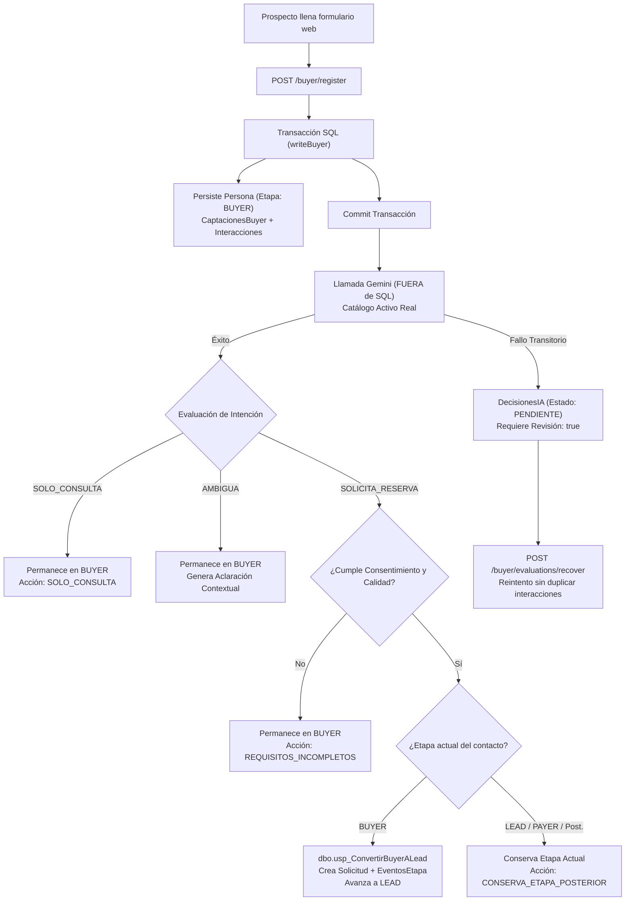

# Entrega del Agente Buyer: Integración de Clasificación Gemini, Orquestación y Entrada a LEAD

Este documento constituye el contrato técnico y operativo de entrega del **Agente Buyer** integrado con el clasificador semántico **Gemini 3.5 Flash Lite** y la base de datos transaccional de ensayo **`NexoSalud_LeadEnsayoFinal`**, como parte de la rama `feature/buyer-agent-gemini`.

---

## 1. Estructura de Componentes y Enlaces al Código

Los componentes desarrollados y adaptados para esta integración se encuentran organizados con rutas relativas al repositorio:

- **Clasificador Semántico Independiente**:  
  [`backend/src/services/buyerMessageClassifier.ts`](file:///backend/src/services/buyerMessageClassifier.ts)  
  Implementa la clasificación con `@google/genai`, modelo `gemini-3.5-flash-lite`, timeout configurable (cancelación vía `AbortSignal`), reintentos exponenciales con jitter, auditoría de duración censurada y validación estricta de `intencion` e `id_servicio`.

- **Servicio de Evaluación y Persistencia Buyer**:  
  [`backend/src/services/buyerEvaluationService.ts`](file:///backend/src/services/buyerEvaluationService.ts)  
  Conecta el clasificador con el catálogo real de servicios activos (`prisma.servicios`), almacena la auditoría persistente en `dbo.DecisionesIA`, genera aclaraciones cordiales para intenciones ambiguas, ejecuta la conversión vía `dbo.usp_ConvertirBuyerALead` y gestiona la recuperación tras caídas/reinicios.

- **Definiciones de Tipos y Contratos**:  
  [`backend/src/types/buyer.ts`](file:///backend/src/types/buyer.ts)  
  Contiene las interfaces y enums de intenciones (`SOLICITA_RESERVA`, `SOLO_CONSULTA`, `AMBIGUA`), estados del ciclo de vida (`PENDIENTE`, `COMPLETADA`, `FALLIDA`), acciones (`CONVERSION_LEAD`, `SOLO_CONSULTA`, `ACLARACION`, `REINTENTO_PENDIENTE`, `CONSERVA_ETAPA_POSTERIOR`, `REQUISITOS_INCOMPLETOS`) y resultados de auditoría.

- **Rutas API del Módulo Buyer**:  
  [`backend/src/routes/buyer.routes.ts`](file:///backend/src/routes/buyer.routes.ts)  
  Adapta `POST /buyer/register` para persistir primero en SQL (`Personas` en etapa `BUYER`, `CaptacionesBuyer` e `Interacciones`), invocar la clasificación fuera de la transacción SQL, e incorpora los endpoints de recuperación (`POST /buyer/evaluations/recover`) y reintento (`POST /buyer/evaluations/:id/retry`).

- **Interfaz Pública y Formulario de Captación**:  
  [`frontend/src/modules/buyer/components/landing/BuyerIntakeForm.tsx`](file:///frontend/src/modules/buyer/components/landing/BuyerIntakeForm.tsx)  
  Presenta la interfaz de registro y visualiza de forma amigable la aclaración automática contextual (`autoClarification`) cuando se requiere más detalle del paciente.

- **Pruebas Automatizadas de Integración**:  
  [`backend/tests/buyerIntegrationFlow.test.ts`](file:///backend/tests/buyerIntegrationFlow.test.ts)  
  Suite integral con 9 pruebas (8 simuladas deterministas y 1 con llamada real a Gemini) ejecutadas sobre `NexoSalud_LeadEnsayoFinal`.

- **Pruebas del Clasificador y CLI**:  
  [`backend/tests/buyerMessageClassifier.test.ts`](file:///backend/tests/buyerMessageClassifier.test.ts)  
  Suite unitaria con 28 pruebas (24 deterministas y 4 reales condicionales).

---

## 2. Flujo Acordado y Reglas de Negocio Implementadas



1. **Permanencia en BUYER**: Todo nuevo contacto se crea inicialmente con `id_etapa_actual = BUYER`. No se promueve a `LEAD` de forma prematura ni automática.
2. **Evaluación fuera de la transacción SQL**: La llamada al clasificador Gemini (con timeout y reintentos) se ejecuta posterior al commit del mensaje en `Interacciones`, evitando bloqueos o transacciones largas en SQL Server.
3. **Persistencia en `dbo.DecisionesIA`**: Se almacena la entrada (`entrada` con snapshot del mensaje y catálogo), regla aplicada (`regla_aplicada`), decisión (`decision` con intentos y duración) y acción (`accion`).
4. **Consultas informativas (`SOLO_CONSULTA`)**: El paciente permanece en etapa `BUYER`, se documenta la respuesta en la interacción y no se crean solicitudes comerciales.
5. **Aclaraciones contextuales (`AMBIGUA`)**: Se genera automáticamente un texto de orientación según palabras clave (precios, horarios, molestia) y se conserva el contexto en `DecisionesIA` para reanudar el hilo.
6. **Conversión con autorización (`SOLICITA_RESERVA`)**: Requiere `autoriza_contacto === true` y calidad válida. Invoca `dbo.usp_ConvertirBuyerALead`, la cual inserta `Solicitudes` ('Abierta'), registra `EventosEtapa` con `clave_operacion_buyer: 'BUYER_LEAD:<id_captacion>'` y actualiza la persona a `LEAD`.
7. **Contactos existentes en etapas posteriores**: Si el contacto ya se encuentra en `LEAD`, `PAYER` u otra fase, se preserva estrictamente su etapa y primera captación, asociando el nuevo mensaje a su expediente o manteniéndolo pendiente según el contrato LEAD.
8. **Recuperación tras reinicio / fallos**: Si Gemini falla, la evaluación queda registrada como `PENDIENTE`. El método `BuyerEvaluationService.recoverPendingEvaluations()` o el endpoint `/buyer/evaluations/recover` permiten reanudar la clasificación reutilizando el mismo `id_interaccion`, sin duplicar filas en la tabla `Interacciones`.

---

## 3. Instrucciones de Ejecución Reproducibles

Todas las instrucciones se ejecutan desde el directorio raíz del proyecto:

### 3.1 Compilación de Código
```bash
# Compilar TypeScript del backend
npm --prefix backend run build

# Compilar frontend (TypeScript + Vite)
npm --prefix frontend run build
```

### 3.2 Ejecución de Pruebas Automatizadas

```bash
# Pruebas simuladas y deterministas completas (incluye clasificador e integración)
npm --prefix frontend test

# Ejecución específica del flujo integrado contra NexoSalud_LeadEnsayoFinal
npm --prefix frontend test -- backend/tests/buyerIntegrationFlow.test.ts

# Ejecución específica del clasificador de mensajes
npm --prefix frontend test -- backend/tests/buyerMessageClassifier.test.ts
```

### 3.3 Activación de Pruebas Reales con Gemini (Opcional)
Para ejecutar las pruebas en vivo contra la API de Gemini:
```powershell
# En PowerShell (Windows):
$env:RUN_LIVE_GEMINI_TESTS='true'; npm --prefix frontend test -- backend/tests/buyerIntegrationFlow.test.ts

# Para retirar la variable al terminar:
Remove-Item Env:\RUN_LIVE_GEMINI_TESTS
```

---

## 4. Evidencia de Verificación

Resultados obtenidos en la suite completa de pruebas:
- **Test Files**: 14 pasados (14/14)
- **Tests**: 72 pasados, 5 omitidos condicionales (77 totales)
- **Pruebas de Integración (`buyerIntegrationFlow.test.ts`)**: 9/9 pasadas (con pruebas en vivo activadas):
  1. Registro en BUYER (permanencia estricta en etapa inicial): **PASS**
  2. Clasificación informativa `SOLO_CONSULTA` (permanencia en BUYER): **PASS**
  3. Aclaración con contexto `AMBIGUA` (aclaración automática y contexto guardado): **PASS**
  4. Conversión válida `SOLICITA_RESERVA` (`dbo.usp_ConvertirBuyerALead` y enlace de clave): **PASS**
  5. Requisitos incumplidos (contacto sin autorización no convierte): **PASS**
  6. Reintento del mismo mensaje (reutiliza `id_interaccion` sin duplicar filas): **PASS**
  7. Conservación de etapa para contactos en fases posteriores (`LEAD`): **PASS**
  8. Recuperación tras reinicio (reanuda evaluaciones `PENDIENTE` en `DecisionesIA`): **PASS**
  9. Llamada real a Gemini con catálogo activo de `NexoSalud_LeadEnsayoFinal`: **PASS (1060ms)**

---

## 5. Coordinación Pendiente con el Equipo LEAD

Para asegurar el acople robusto de extremo a extremo entre los agentes Buyer y LEAD, se documentan los siguientes puntos de coordinación que debe asumir el equipo LEAD:

### 5.1 Detección e Inicio Idempotente del Agente LEAD por `id_solicitud`
- **Responsabilidad Buyer**: Buyer ejecuta la conversión formal llamando a `dbo.usp_ConvertirBuyerALead`, obteniendo y devolviendo los identificadores `id_solicitud`, `id_evento_etapa` y `ya_convertido`, enlazando además `dbo.Interacciones.id_solicitud`.
- **Acción requerida en LEAD**: El agente LEAD debe escuchar o sondear solicitudes con `estado = 'Abierta'` cuyo evento de origen sea `BUYER_LEAD:<id_captacion>`. Debe implementar un cerrojo o verificación de idempotencia por `id_solicitud` para garantizar que la negociación comercial (envío de propuestas o asignación de asesor) se inicie **exactamente una vez** por solicitud.

### 5.2 Recuperación ante una Caída Inmediatamente Posterior a la Conversión
- **Escenario**: Si el servidor experimenta una caída inesperada inmediatamente después del `COMMIT` de `dbo.usp_ConvertirBuyerALead` y antes de que Buyer retorne la respuesta HTTP o notifique a LEAD:
- **Mecanismo de reconciliación**:
  - `dbo.EventosEtapa` ya contiene la fila con `clave_operacion_buyer = 'BUYER_LEAD:<id_captacion>'`.
  - `dbo.Solicitudes` ya existe con estado `'Abierta'`.
  - `dbo.DecisionesIA` registra la acción `'CONVERSION_LEAD'`.
  - LEAD y Buyer deben utilizar una rutina periódica de sincronización que detecte solicitudes huérfanas en estado `'Abierta'` sin propuesta inicial y active el agente LEAD sin reprocesar al Buyer.

### 5.3 Pruebas Conjuntas con Señal Repetida y Recuperación tras Caída
- Se debe programar una sesión de pruebas de integración conjunta entre ambos equipos para:
  1. Enviar una petición web con un `Idempotency-Key` ya procesado y comprobar que LEAD no genere una segunda conversación paralela.
  2. Forzar la interrupción del backend durante la llamada a Gemini y verificar que el proceso de recuperación (`recoverPendingEvaluations()`) reanude la solicitud y LEAD la tome limpiamente.

### 5.4 Apertura de Oportunidades Nuevas para Contactos en Etapas Posteriores
- **Escenario**: Un contacto que ya se encuentra en `LEAD`, `PAYER`, `CUSTOMER` o `TURNED` envía un nuevo mensaje solicitando una reserva adicional o un nuevo tratamiento.
- **Comportamiento Buyer actual**: Buyer **no** invoca `dbo.usp_ConvertirBuyerALead` (lo cual generaría el error SQL 51003 por no encontrarse en etapa `BUYER`) y preserva su etapa actual, registrando la interacción y documentando en `DecisionesIA` la acción `'CONSERVA_ETAPA_POSTERIOR'`.
- **Acuerdo pendiente con LEAD**: Definir el procedimiento o endpoint específico para que LEAD decida si el mensaje se anexa a su solicitud abierta vigente o si se ejecuta un procedimiento de apertura de una segunda oportunidad comercial independiente para pacientes recurrentes.

### 5.5 Cambios Compartidos de Prisma y Esquema SQL
- **Columna `id_solicitud` en `dbo.Interacciones`**:
  En el esquema base de `NexoSalud_LeadEnsayoFinal`, `dbo.Interacciones` no contaba con la columna `id_solicitud` que el equipo LEAD introdujo en `backend/prisma/schema.prisma` y en `database/lead_revision/INSTALAR_LEAD_COMPLETO.sql:237`. Se aplicó la sentencia idempotente:
  ```sql
  IF COL_LENGTH('dbo.Interacciones','id_solicitud') IS NULL
    ALTER TABLE dbo.Interacciones ADD id_solicitud INT NULL;
  ```
  Se requiere que el equipo LEAD confirme la inclusión formal de esta columna en los scripts de migración baseline de QA y Producción.
- **Campos en `dbo.DecisionesIA`**:
  Se incorporaron `id_captacion Int?` e `id_interaccion Int?` en `backend/prisma/schema.prisma` para reflejar las columnas y claves foráneas que ya existen en SQL Server (`FK_DecisionesIA_CaptacionBuyer` y `FK_DecisionesIA_InteraccionBuyer`).
- **Columnas Comerciales de `dbo.Solicitudes`**:
  Se recomienda que los modelos Prisma mantengan sincronía estricta con las tablas físicas de la base de datos de destino para evitar errores de proyección en entornos donde los scripts de LEAD aún no se hayan desplegado completamente.

