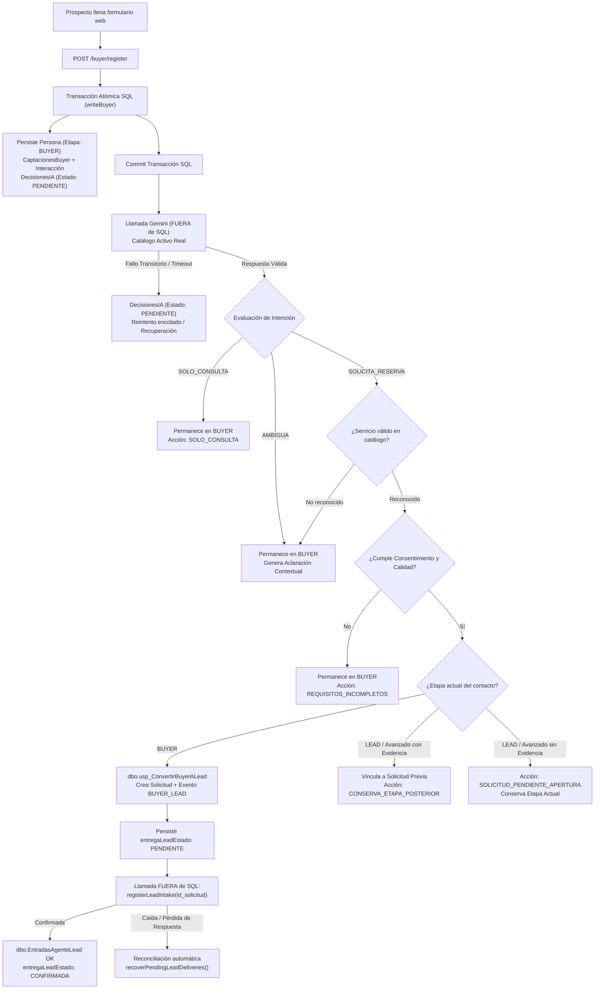

# Entrega del Agente Buyer: Integración de Clasificación Gemini, Orquestación y Entrada a LEAD

Este documento constituye el contrato técnico y operativo de entrega del **Agente Buyer** integrado con el clasificador semántico **Gemini 3.5 Flash Lite** y el flujo de entrada formal acordado con el equipo LEAD, referenciado en [CONTRATO_BUYER_LEAD.md](../../database/lead_revision/CONTRATO_BUYER_LEAD.md).

---

## 1. Estructura de Componentes y Enlaces al Código

Los componentes desarrollados y validados para esta integración utilizan rutas relativas al repositorio:

- **Contrato de Integración y Entrega a LEAD**:  
  [`database/lead_revision/CONTRATO_BUYER_LEAD.md`](../../database/lead_revision/CONTRATO_BUYER_LEAD.md)  
  Documenta el contrato de entrega formal de solicitudes desde BUYER hacia LEAD a través de `dbo.usp_RegistrarEntradaAgenteLead` y `dbo.EntradasAgenteLead`.

- **Propuesta de Esquema Compartido BUYER <-> LEAD**:  
  [`database/buyer_revision/PROPUESTA_ESQUEMA_COMPARTIDO_BUYER_LEAD.sql`](../../database/buyer_revision/PROPUESTA_ESQUEMA_COMPARTIDO_BUYER_LEAD.sql)  
  Script SQL reproducible con guardas de seguridad unificadas para entornos QA (`NexoSalud_LeadEnsayoFinal` y `NexoSalud_LeadPruebas`), asegurando las columnas `dbo.Interacciones.id_solicitud`, `dbo.DecisionesIA.id_captacion`, `dbo.DecisionesIA.id_interaccion`, la tabla `dbo.EntradasAgenteLead` y el procedimiento `dbo.usp_RegistrarEntradaAgenteLead`.

- **Función Interna de Entrada LEAD (`registerLeadIntake`)**:  
  [`backend/src/services/leadIntake.ts`](../../backend/src/services/leadIntake.ts)  
  Ejecuta la entrega desacoplada fuera de la transacción SQL contra `dbo.usp_RegistrarEntradaAgenteLead`, aceptando cliente de base de datos configurable y validando el rango de enteros positivos seguros.

- **Clasificador Semántico Independiente**:  
  [`backend/src/services/buyerMessageClassifier.ts`](../../backend/src/services/buyerMessageClassifier.ts)  
  Implementa la clasificación con `@google/genai` (v3.1.0), modelo `gemini-3.5-flash-lite`, timeout por petición con cancelación efectiva (`AbortSignal`), reintentos exponenciales con jitter, registro de métricas censuradas (`intentosRealizados`, `duracionTotalMs`), validación estricta de `intencion` e `id_servicio` (rechazando booleanos, cadenas, arrays y decimales; `AMBIGUA` siempre normaliza a `id_servicio: null`).

- **Servicio de Evaluación y Persistencia Buyer**:  
  [`backend/src/services/buyerEvaluationService.ts`](../../backend/src/services/buyerEvaluationService.ts)  
  Orquesta la persistencia atómica de interacciones y trabajo pendiente en `dbo.DecisionesIA`, consulta del catálogo activo real, llamadas a Gemini fuera de transacciones SQL, aclaraciones en dos turnos con contexto, conversión vía `dbo.usp_ConvertirBuyerALead`, entrega fuera de transacción a `registerLeadIntake`, cerrojo in-flight contra peticiones concurrentes y recuperación automática tras caídas (`recoverPendingEvaluations` y `recoverPendingLeadDeliveries`).

- **Definiciones de Tipos y Contratos**:  
  [`backend/src/types/buyer.ts`](../../backend/src/types/buyer.ts)  
  Contiene interfaces de clasificación, catálogo de servicios, métricas de auditoría (`intentosRealizados`, `duracionTotalMs`), acciones del clasificador (incluyendo `SOLICITUD_PENDIENTE_APERTURA` y `CONSERVA_ETAPA_POSTERIOR`) y contexto conversacional para aclaraciones (`BuyerClarificationContext`).

- **Rutas API del Módulo Buyer**:  
  [`backend/src/routes/buyer.routes.ts`](../../backend/src/routes/buyer.routes.ts)  
  Adapta `POST /buyer/register` para persistencia transaccional de persona, captación e interacción con trabajo pendiente (`PENDIENTE`), detección de duplicados e idempotencia persistente por hash de mensaje. Expone `POST /buyer/evaluations/recover` y `POST /buyer/evaluations/:id/retry`.

- **Control de Sincronización Analítica**:  
  [`backend/src/services/martSyncService.ts`](../../backend/src/services/martSyncService.ts)  
  Garantiza que la sincronización analítica hacia `NexoSalud_Mart` permanezca desactivada por defecto durante QA y pruebas (`RUN_SQL_TESTS=true` o `QA_ENV=true`), activándose únicamente ante la bandera explícita `ENABLE_MART_SYNC=true`.

- **Interfaz Pública y Formulario de Captación**:  
  [`frontend/src/modules/buyer/components/landing/BuyerIntakeForm.tsx`](../../frontend/src/modules/buyer/components/landing/BuyerIntakeForm.tsx)  
  Formulario de admisión con continuación interactiva de aclaraciones en dos turnos (`id_interaccion_previa`), diferenciación de reenvíos idénticos y reemplazo de promesas rígidas por textos configurables según disponibilidad de sede.

- **Servicio Frontend de Buyer**:  
  [`frontend/src/modules/buyer/services/buyer.service.ts`](../../frontend/src/modules/buyer/services/buyer.service.ts)  
  Conexión HTTP que soporta el envío de `id_interaccion_previa` para continuar hilos conversacionales y preserva cabeceras de idempotencia.

- **Pruebas Automatizadas de Integración**:  
  [`backend/tests/buyerIntegrationFlow.test.ts`](../../backend/tests/buyerIntegrationFlow.test.ts)  
  Suite completa con 15 casos de prueba protegidos con la bandera `RUN_SQL_TESTS=true`, verificación de `DB_NAME()` en guarda antes de escribir, reporte visible de errores de limpieza y cobertura de rutas HTTP, concurrencia, aclaraciones en dos turnos, servicios desconocidos y entregas repetidas a LEAD.

- **Pruebas Unitarias del Clasificador**:  
  [`backend/tests/buyerMessageClassifier.test.ts`](../../backend/tests/buyerMessageClassifier.test.ts)  
  Suite con 28 pruebas unitarias (24 simuladas deterministas y 4 reales condicionales mediante `RUN_LIVE_GEMINI_TESTS=true`).

---

## 2. Flujo Acordado y Reglas de Negocio Implementadas



### Detalle de las 11 Correcciones del Acuerdo LEAD

1. **Incorporación Limpia de `origin/lead` (commit `b819dd5`)**:  
   Se integraron sin conflicto los scripts y procedimientos del equipo LEAD (`leadIntake.ts`, `provision-lead-staff.ts`, `CONTRATO_BUYER_LEAD.md`), preservando la dependencia `@google/genai` (^3.1.0) y los tipos compartidos.

2. **Eliminación Total de Sustitutos por Defecto (Servicio 1 / Primer Activo)**:  
   Si el clasificador o el mensaje indican una intención de reserva pero el servicio no pertenece al catálogo activo (o es nulo), el sistema **no** asigna el ID 1 ni el primer elemento de la lista. En su lugar, emite una solicitud cordial de aclaración (`accion: 'ACLARACION'`) y permanece en etapa `BUYER`.

3. **Idempotencia Persistente del Registro por Mensaje**:  
   Se computa el hash SHA-256 del contenido del mensaje para identificar peticiones idénticas. La interacción y el trabajo pendiente (`dbo.DecisionesIA` con `estado: 'PENDIENTE'`) se graban dentro de la misma transacción atómica. Si se recibe un reenvío del mismo mensaje completado previamente, se devuelve la decisión persistida sin duplicar filas.

4. **Continuación Interactiva de Aclaraciones desde la Interfaz**:  
   En [`BuyerIntakeForm.tsx`](../../frontend/src/modules/buyer/components/landing/BuyerIntakeForm.tsx), al recibir una aclaración preliminar del agente, el usuario dispone de un campo específico para responder y precisar su necesidad. La respuesta se envía con el parámetro `id_interaccion_previa`, permitiendo al evaluador semántico unir la consulta anterior y la nueva respuesta en un prompt contextual de dos turnos. Se diferencia explícitamente un mensaje nuevo de un reenvío del mensaje original.

5. **Contactos Avanzados y Evidencia Contextual**:  
   Si el contacto ya se encuentra en `LEAD`, `PAYER` u otra etapa posterior, el sistema evalúa si el mensaje contiene evidencia de una solicitud existente (ej. código `#123` o referencias explícitas a cotizaciones previas). Solo en ese caso se vincula (`CONSERVA_ETAPA_POSTERIOR`). Si se trata de una nueva intención sin evidencia directa, se marca como `SOLICITUD_PENDIENTE_APERTURA` manteniendo la etapa, a la espera del flujo acordado con LEAD.

6. **Entrega Desacoplada y Confirmada a LEAD (`registerLeadIntake`)**:  
   Tras el `COMMIT` de la conversión SQL (`dbo.usp_ConvertirBuyerALead`), se llama a `registerLeadIntake(id_solicitud)` **fuera de la transacción**, garantizando `@@TRANCOUNT == 0` (cumpliendo con la restricción de `dbo.usp_RegistrarEntradaAgenteLead`). El estado se audita como `entregaLeadEstado: 'PENDIENTE'` antes de la llamada y se actualiza a `'CONFIRMADA'` tras recibir la respuesta. Las caídas posteriores al commit o pérdidas de respuesta se recuperan mediante `recoverPendingLeadDeliveries()`.

7. **Desactivación de Sincronización Analítica en QA**:  
   [`MartSyncService.isSyncEnabled()`](../../backend/src/services/martSyncService.ts) desactiva la sincronización hacia `NexoSalud_Mart` en entornos de prueba (`RUN_SQL_TESTS=true` o `QA_ENV=true`) hasta que los procedimientos y destinos analíticos estén formalmente verificados. Requiere `ENABLE_MART_SYNC=true` para activarse.

8. **Propuesta Mínima y Reproducible de Esquema Compartido**:  
   En [`PROPUESTA_ESQUEMA_COMPARTIDO_BUYER_LEAD.sql`](../../database/buyer_revision/PROPUESTA_ESQUEMA_COMPARTIDO_BUYER_LEAD.sql) se unificó la guarda QA para admitir tanto `NexoSalud_LeadEnsayoFinal` como `NexoSalud_LeadPruebas`, garantizando la idempotencia en la creación de `dbo.EntradasAgenteLead` y `dbo.usp_RegistrarEntradaAgenteLead`.

9. **Pruebas SQL con Activación Explícita y Guarda de Base de Datos**:  
   En [`buyerIntegrationFlow.test.ts`](../../backend/tests/buyerIntegrationFlow.test.ts), la suite SQL solo corre cuando `$env:RUN_SQL_TESTS='true'`. Verifica mediante `SELECT DB_NAME() AS current_db` que la conexión sea a `NexoSalud_LeadEnsayoFinal` o `NexoSalud_LeadPruebas` antes de escribir. Los errores de limpieza en `afterAll` se reportan visiblemente en consola.

10. **Métricas de Auditoría y Descompromiso de Promesas Fijas**:  
    Se normalizó el uso de `intentosRealizados` (y `duracionTotalMs`) como contador oficial de intentos. En frontend y respuestas automáticas se eliminaron horarios fijos ("Lun a Sáb 8:00 AM – 8:00 PM") y promesas ("en menos de 15 minutos", "hoy mismo"), sustituyéndolos por respuestas descomprometidas ("a la brevedad dentro de nuestros horarios de atención", "según disponibilidad de cada sede").

11. **Alineación con el Contrato Técnico LEAD**:  
    El clasificador y orquestador Buyer cumplen plenamente con las expectativas descritas en [CONTRATO_BUYER_LEAD.md](../../database/lead_revision/CONTRATO_BUYER_LEAD.md).

---

## 3. Instrucciones de Ejecución Reproducibles

Todas las instrucciones se ejecutan desde el directorio raíz del repositorio en PowerShell:

### 3.1 Compilación Completa

```powershell
# Compilar TypeScript del backend
npm --prefix backend run build

# Compilar frontend (TypeScript + Vite)
npm --prefix frontend run build
```

### 3.2 Pruebas Simuladas y Deterministas (Sin tocar SQL ni Gemini)

```powershell
# Ejecución general de pruebas unitarias y mocks
npm --prefix frontend test

# Pruebas del clasificador semántico
npm --prefix frontend test -- backend/tests/buyerMessageClassifier.test.ts
```

### 3.3 Pruebas de Integración SQL contra `NexoSalud_LeadEnsayoFinal`

```powershell
# Ejecutar la suite completa de integración contra la base de datos QA
$env:RUN_SQL_TESTS='true'; npm --prefix frontend test -- backend/tests/buyerIntegrationFlow.test.ts

# Para retirar la variable al terminar:
Remove-Item Env:\RUN_SQL_TESTS
```

### 3.4 Pruebas Reales con la API de Gemini (Opcional)

```powershell
# Requiere GEMINI_API_KEY configurada
$env:RUN_LIVE_GEMINI_TESTS='true'; npm --prefix frontend test -- backend/tests/buyerMessageClassifier.test.ts

# Para retirar la variable al terminar:
Remove-Item Env:\RUN_LIVE_GEMINI_TESTS
```

---

## 4. Evidencia de Verificación

Resultados obtenidos en las comprobaciones automatizadas:

| Componente | Comando | Resultado |
|---|---|---|
| **Compilación Backend** | `npm --prefix backend run build` | **EXIT 0** (0 errores de tipo) |
| **Compilación Frontend** | `npm --prefix frontend run build` | **EXIT 0** (Build generado en dist/) |
| **Suite Vitest Completa** | `npm --prefix frontend test` | **16 passed \| 1 skipped (76 tests passed)** |
| **Integración SQL (`buyerIntegrationFlow`)** | `$env:RUN_SQL_TESTS='true'; ...` | **1 passed (14 tests passed, 1 skipped)** |

### Detalle de los 14 Casos de Integración Validados en SQL

1. `Registro en BUYER`: el nuevo contacto permanece estrictamente en `BUYER` antes de evaluar intención. (**PASS**)
2. `Clasificación informativa`: consulta de horarios permanece en `BUYER` sin crear solicitud. (**PASS**)
3. `Aclaración con contexto`: mensaje vago genera orientación cordial y preserva entrada. (**PASS**)
4. `Conversión válida`: intención explícita de reserva convierte a `LEAD` vía `dbo.usp_ConvertirBuyerALead` y registra en `dbo.EntradasAgenteLead`. (**PASS**)
5. `Requisitos incumplidos`: sin autorización de contacto, la reserva permanece en `BUYER`. (**PASS**)
6. `Reintento del mismo mensaje`: `retryEvaluationByInteraction` procesa el mismo ID sin duplicar interacciones. (**PASS**)
7. `Contactos avanzados sin evidencia`: nueva solicitud permanece pendiente de apertura (`SOLICITUD_PENDIENTE_APERTURA`). (**PASS**)
8. `Contactos avanzados con evidencia`: vincula solicitud abierta previa (`CONSERVA_ETAPA_POSTERIOR`). (**PASS**)
9. `Recuperación tras reinicio`: reanuda evaluaciones `PENDIENTE` en `dbo.DecisionesIA` tras caída del servicio. (**PASS**)
10. `Entrega repetida a LEAD`: llamadas sucesivas a `registerLeadIntake` son estrictamente idempotentes. (**PASS**)
11. `Servicio desconocido`: intención de reserva sin tratamiento del catálogo solicita aclaración sin sustituir por servicio 1. (**PASS**)
12. `Aclaraciones en dos turnos`: turno 1 pide aclaración y turno 2 con `id_interaccion_previa` resuelve y convierte a `LEAD`. (**PASS**)
13. `Reenvíos concurrentes`: peticiones simultáneas del mismo mensaje son serializadas sin duplicar registros. (**PASS**)
14. `Rutas HTTP`: `POST /buyer/register` y `POST /buyer/evaluations/recover` responden con códigos (200/201) y contrato esperado. (**PASS**)
