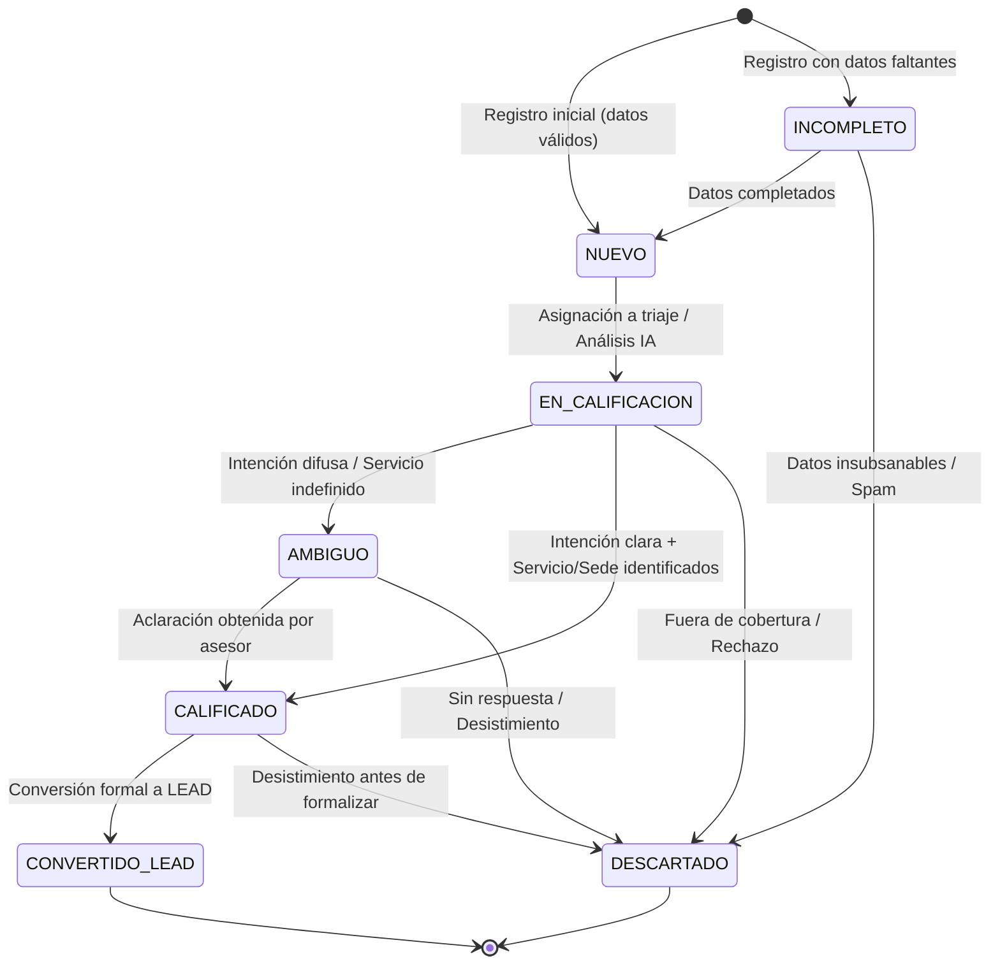

# ESPECIFICACIÓN FUNCIONAL, REGLAS DE NEGOCIO Y CONTRATOS DE API — FASE BUYER (NEXOSALUD)

## 1. INTRODUCCIÓN Y ARQUITECTURA CONCEPTUAL

La fase **BUYER** de la metodología IMPULSE en NexoSalud tiene la responsabilidad de captar, registrar, calificar y preparar a personas interesadas en servicios odontológicos antes de su paso a la fase **LEAD**.

Se establece una distinción formal entre cuatro conceptos arquitectónicos:
1. **Persona (`Personas`)**: Identidad única y duradera del individuo (DNI, Nombres, Apellidos, Teléfono, Correo). No se duplica cuando el usuario regresa o interactúa por distintos canales.
2. **Oportunidad de Captación (`OportunidadesCaptacion`)**: Episodio comercial específico que vincula a una persona con un canal, fuente, campaña, servicio de interés y sede en un momento determinado. Una persona puede tener múltiples oportunidades en el tiempo.
3. **Interacción (`Interacciones`)**: Contacto, llamada, mensaje o intercambio registrado entre el interesado y la clínica (o el agente inteligente).
4. **Solicitud (`Solicitudes`)**: Requerimiento formal generado cuando la oportunidad BUYER madura y se convierte a la fase **LEAD** (Etapa 2).

---

## 2. MÁQUINA DE ESTADOS DE LA OPORTUNIDAD (`OportunidadesCaptacion`)

Cada oportunidad comercial en BUYER transita por una máquina de estados determinista y auditable:



### Tabla de Estados y Reglas de Transición

| Estado | Significado | Condición de Entrada | Siguiente Estado Permitido | Motivo Obligatorio |
| :--- | :--- | :--- | :--- | :---: |
| **`NUEVO`** | Oportunidad registrada con teléfono válido y nombre completo. | Teléfono normalizado de 9 dígitos y consentimiento de atención. | `EN_CALIFICACION`, `INCOMPLETO`, `DESCARTADO` | No |
| **`INCOMPLETO`** | Falta información de contacto o necesidad mínima. | No cumple longitud de nombre o teléfono ambiguo. | `NUEVO`, `DESCARTADO` | Sí |
| **`EN_CALIFICACION`** | Bajo evaluación del asesor o del Agente IA. | Activación de análisis comercial. | `CALIFICADO`, `AMBIGUO`, `DESCARTADO` | No |
| **`AMBIGUO`** | Consulta no odontológica, múltiple o contradictoria. | IA o asesor detecta necesidad de repregunta. | `CALIFICADO`, `DESCARTADO` | Sí |
| **`CALIFICADO`** | Servicio, sede y requerimiento concreto confirmados. | Intención comercial evidente y verificable. | `CONVERTIDO_LEAD`, `DESCARTADO` | No |
| **`CONVERTIDO_LEAD`** | Oportunidad exitosa convertida a Solicitud LEAD. | `id_solicitud` generado, `id_etapa_actual = 2`, evento de etapa registrado. | *(Terminal)* | No |
| **`DESCARTADO`** | Oportunidad no viable comercialmente. | Spam, duplicado erróneo, desistimiento expreso, número inoperativo. | *(Terminal)* | Sí |

---

## 3. MARCO JURÍDICO DE CONSENTIMIENTO (LEY N° 29733 - PERÚ)

Para cumplir estrictamente con el principio de finalidad y consentimiento libre, previo, expreso e informado:

1. **Consentimiento de Atención (`consentimiento_atencion`)**:
   - **Obligatorio (true)**: Tratamiento indispensable de los datos de contacto suministrados por el propio interesado para atender su solicitud específica de información, costos u horarios odontológicos.
2. **Consentimiento Promocional (`consentimiento_promocional`)**:
   - **Opcional (true/false)**: Autorización explícita para recibir ofertas comerciales, promociones futuras o boletines de salud oral. Su rechazo **nunca** bloquea la atención de la consulta solicitada.
3. **Consentimiento para IA (`consentimiento_ia`)**:
   - **Informativo / Condicional**: Se procesa con datos mínimos seudonimizados (sin DNI ni apellidos completos) al invocar proveedores LLM en la nube.
4. **Prohibición de Sobrescritura**:
   - Queda estrictamente prohibido que cualquier endpoint backend (ej. `/convert`) asigne forzosamente `autoriza_contacto = true` si el usuario no lo otorgó.

---

## 4. CONTRATOS DE API — ENDPOINTS DE LA FASE BUYER

### 4.1. Registro Omnicanal (`POST /api/buyer/register`)
- **Propósito**: Recibir solicitudes desde Landing Page, WhatsApp manual, formulario administrativo o campañas.
- **Regla Fundamental**: El interesado se registra en la Etapa 1 (`BUYER`). **No se auto-convierte a LEAD**. Si la solicitud web ya contiene todos los datos y expresa cotización inmediata, se califica como `CALIFICADO`, permitiendo su conversión síncrona opcional únicamente si se envía el flag `autoConvertIfQualified: true` con justificación.

#### Request Payload:
```json
{
  "nombres": "Carlos",
  "apellidos": "Mendoza",
  "email": "carlos.mendoza@email.com",
  "telefono": "987654321",
  "dni": "45879632",
  "id_canal": 1,
  "id_fuente": 2,
  "id_campana": 3,
  "id_servicio_interes": 2,
  "id_sede_preferida": 1,
  "mensaje_consulta": "Buenas tardes, quisiera saber el precio de una endodoncia y si atienden los sábados.",
  "consentimiento_atencion": true,
  "consentimiento_promocional": false,
  "consentimiento_ia": true,
  "metadata_origen": {
    "utm_source": "facebook",
    "utm_campaign": "ortodoncia_verano_2026",
    "device": "mobile"
  }
}
```

#### Response Payload (201 Created):
```json
{
  "success": true,
  "message": "Oportunidad de captación registrada exitosamente en fase BUYER",
  "data": {
    "id_persona": 105,
    "id_oportunidad": 312,
    "etapa_actual": "BUYER",
    "estado_oportunidad": "NUEVO",
    "analisis_ia": {
      "intencion": "INFORMACION_PRECIO",
      "servicio_sugerido": "Endodoncia",
      "calidad_registro": "ALTA",
      "recomendacion": "CALIFICAR"
    },
    "alertas_activas": []
  }
}
```

---

### 4.2. Listado de Oportunidades (`GET /api/buyer/opportunities`)
- **Query Params**: `estado`, `canal`, `fuente`, `sede`, `busqueda`, `page`, `limit`, `fecha_desde`, `fecha_hasta`.
- **Response**: Listado paginado de oportunidades con datos de la persona física, estado comercial, última interacción y alertas vigentes.

---

### 4.3. Detalle de Oportunidad (`GET /api/buyer/opportunities/:id`)
- **Response**: Vista consolidada 360°:
  - Ficha de la persona (identidad y consentimientos).
  - Datos de la oportunidad (origen, campaña, servicio, sede, estado).
  - Historial de interacciones.
  - Decisiones de IA registradas en base de datos.
  - Alertas Impulse vigentes e historial de resolución.

---

### 4.4. Transición de Estado (`PATCH /api/buyer/opportunities/:id/status`)
- **Propósito**: Ejecutar una transición en la máquina de estados.
- **Payload**:
```json
{
  "nuevo_estado": "AMBIGUO",
  "motivo": "El usuario preguntó por servicios que no corresponden al catálogo odontológico.",
  "id_usuario": 1
}
```

---

### 4.5. Conversión Formal a LEAD (`POST /api/buyer/opportunities/:id/convert`)
- **Propósito**: Madurar la oportunidad BUYER hacia una `Solicitud` LEAD formal.
- **Precondiciones**:
  1. Oportunidad en estado `CALIFICADO` (o transicionable a calificado con motivo).
  2. Persona en Etapa 1 (`BUYER`).
  3. `consentimiento_atencion == true`.
- **Operaciones Atómicas (Transacción SQL Server)**:
  1. Generar registro en `Solicitudes` con tipo de consulta, servicio y sede.
  2. Actualizar `OportunidadesCaptacion` a `CONVERTIDO_LEAD`, enlazando `id_solicitud`.
  3. Actualizar `Personas.id_etapa_actual = 2` (LEAD).
  4. Insertar en `EventosEtapa` (Etapa Origen: 1 -> Etapa Destino: 2, motivo: "Conversión formal desde oportunidad de captación BUYER").
  5. Resolver alertas pendientes de tipo `INTENCION_AMBIGUA` o `REGISTRO_INCOMPLETO`.

#### Response Payload (200 OK):
```json
{
  "success": true,
  "message": "Oportunidad convertida a LEAD exitosamente",
  "data": {
    "id_oportunidad": 312,
    "id_solicitud": 84,
    "id_persona": 105,
    "etapa_previa": "BUYER",
    "etapa_nueva": "LEAD",
    "fecha_conversion": "2026-10-26T14:00:00Z"
  }
}
```

---

### 4.6. Verificación de Duplicados (`GET /api/buyer/check-duplicate`)
- **Query Params**: `telefono`, `email`, `dni`.
- **Criterio de Normalización**:
  - Teléfono: Limpieza de prefijos `+51`, espacios, guiones -> 9 dígitos exactos.
  - Correo: `toLowerCase()` y trim.
- **Respuesta**: No bloquea tajantemente ante teléfonos compartidos (ej. madre e hijo); reporta coincidencia para que el asesor decida si es una nueva oportunidad de la misma persona o un familiar dependiente.
